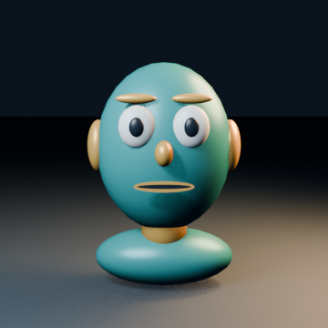
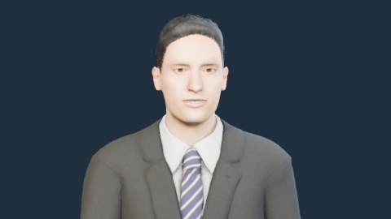
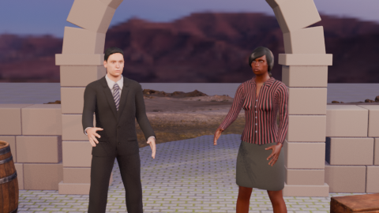

# ATLAS V0.5.1 delivery report

The repository now generates clothed MPFB characters in background Blender and registers embedded human GLBs with validated skinning, skeletal actions and facial controls. V0.5.1 adds Poly Haven scan acquisition, ambientCG PBR sets, a curated Smithsonian Open Access model, and four reusable quality profiles. Projects 1.0 through 1.3 remain covered by regression tests. Implementation commit `6e5640188e3a40fac4fc2d7a192178ebd1766aa4`. [Reproduction commands](V051_DEMOS.md) · [Evidence with hashes and exact output paths](evidence/2026-11-25-v051.json)

## Starter library

| Category | Verified delivery | Target |
| --- | ---: | ---: |
| Generated and inspected human assets | 5 | 5 |
| Distinct appearance profiles | 5 | 5 |
| Facial-ready humans | 5 inspected, 2 used in a dialogue | 1 or more |
| Compatible human action types | 2 authored, 10 bindings across the cast | 15–30 clips |
| High-fidelity environment models | 5 | 20 |
| Historical artifact models | 1 | 10 |
| Compatible wardrobe items | 5 outfits and 1 shoe model | 10 |
| PBR materials | 2 unique sets, 4 Blender-verified derivatives | 30 |
| HDRIs | 5 acquired, 1 lit the courtyard demos | 5 |
| Environment collections | 3 validated, 1 used across three projects | 3 |

The humans each use one 53-bone MPFB game-engine rig, nine skinned meshes, 10–11 embedded textures, eight visemes and four jaw, brow and blink shapes. The Poly Haven models include scanned coast rocks, a crate, a barrel and a stone. The historical model is the CC0 Cooper Hewitt Rococo side chair dated 1750–60. AmbientCG Paving Stones and Wood099 were decoded and packed with sRGB color and Non-Color data maps. Ground shading connects roughness, normal and optional occlusion, height, metallic, emission and opacity channels as available. The provider catalog can distinguish photorealistic assets from stylized KayKit inventory. [Sources and rights](HIGH_FIDELITY_SOURCES.md)

## Rendered demonstrations

| Example | Verified output | Wall time |
| --- | --- | ---: |
| Five-person MPFB showcase | 640 × 294, 30 frames, 2.50 s | 295.69 s |
| Human close-up with Turbo speech | 480 × 270, 116 frames, 4.83 s | 333.00 s |
| Full-body idle and gesture | 384 × 376, 48 frames, 4.00 s | 286.98 s |
| Courtyard camera move | 432 × 244, 30 frames, 3.00 s | 138.49 s |
| Two-speaker courtyard dialogue | 480 × 270, 112 frames, 9.33 s | 370.50 s |
| Cycles cast and courtyard stills | 1000 × 460 and 960 × 540 | 47.29 s and 62.08 s |

Times are observed job wall times on Windows, Intel Core 7 240H and integrated graphics with concurrent work. Fresh per-human generation and inspection took 17.16–18.59 seconds. The 3.67-second question and 4.03-second reply took 27.40 and 17.76 seconds of CPU Turbo inference including model load. Rhubarb produced 22 and 25 cues on those exact WAVs. The close-up uses the baseline's 4.27-second utterance and 29 measured cues. Reopening the close-up showed a peak viseme of 0.85, jaw movement, two blinks and approximately 2° of independently animated head rotation. Both courtyard actors use cue-driven mouth shapes, editable body actions and scheduled blinks. The dialogue render used the earlier wide-vowel jaw mapping, so the explicit jaw key moved only on the reply. Updated audio sidecars in `outputs/v051-audio` point to each take's own cache key and resolve the same rendered waveform hashes.

Both dialogue MP4s contain AAC synchronized to the validated scene duration and were fully decoded with FFmpeg. Quality grades use AgX and scene-configurable exposure. The two stills exercised the cinematic Cycles path and the videos used reduced-resolution Eevee settings. The editable source scenes and imported textures are retained locally. [Frame counts, paths and measured motion](evidence/2026-11-25-v051.json)

| V0.5 original talking head | V0.5.1 MPFB close-up |
| --- | --- |
|  |  |

## Verification and storage

- Fresh V0.5 baseline was 227 passed and one skip. The full V0.5.1 regression run was 243 passed and one Windows symlink privilege skip, with Blender, Turbo, KayKit and MPFB integrations enabled. The post-review suite passed 21 targeted tests after the generation cache, importer and jaw adjustments. The CLI suite passed five checks after adding the flythrough configuration.
- The installed `atlas_animation-0.5.1-py3-none-any.whl` rendered an inspected human to a decoded MP4 outside the source tree. Reviewer feedback led to independent cache staging per generation, atomic publication and Blender build and facial control inputs in cache identity.
- Source caches measured 203.2 MB for providers and 326.9 MB for MPFB archives. The installed Blender profile used 380.1 MB and the ten approved GLB derivatives used 164.4 MB. These measurements exclude local speech weights and temporary render folders. Original sources and rendered MP4s stay outside Git.
- Production supports static GLB, vetted single-buffer glTF packed to GLB, approved single-rig animated GLB and the bounded human morph profile. Environment media supports HDR and bundled PNG/JPEG maps. MPFB outputs an editable source blend and ATLAS saves an editable production blend.

## Remaining scope

The courtyard is an original block-built visualization with photogrammetry, textured paving, a documented period artifact and a visible rock-to-ground seam. The outfits are modern, and both voices use the bundled Turbo conditioning. The short human body clips use authored upper-body movements with mostly planted feet and stylized hand poses. Acquired motion retargeting, locomotion, actor-specific voices, historically appropriate wardrobe, licensed architectural scans and wider collection targets remain open. The next recommended development phase is one vetted locomotion capture retargeted onto the MPFB rest rig, followed by foot contact checks, fitted historical garments and a documented architectural acquisition.
