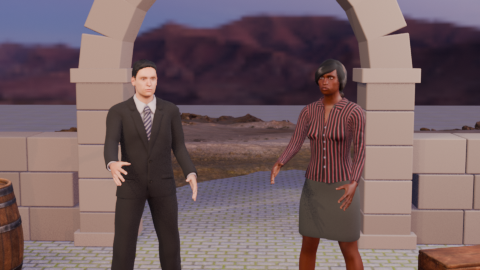
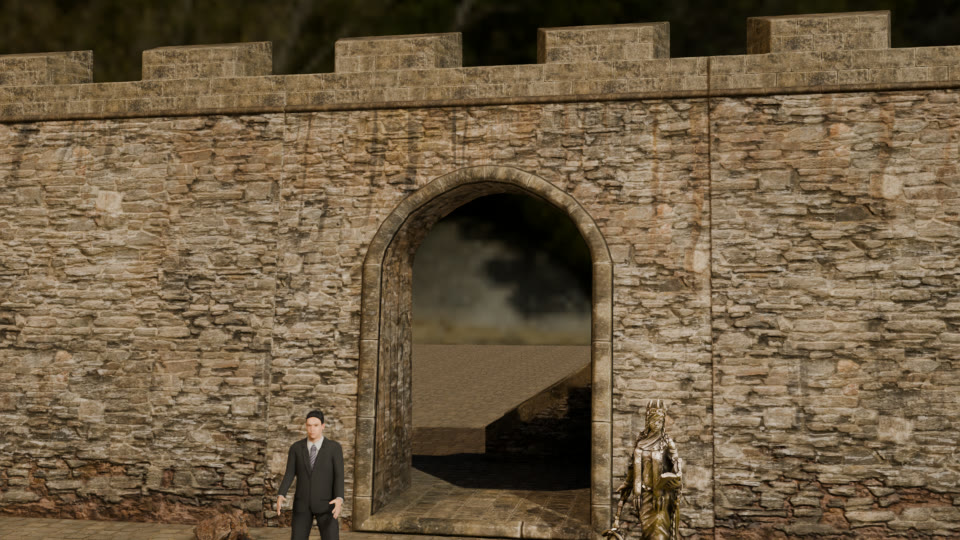
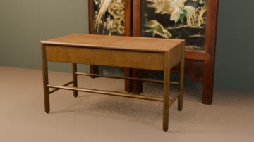
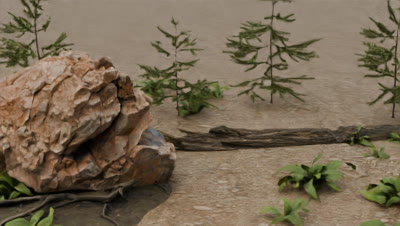

# ATLAS V0.5.2 delivery report

ATLAS now acquires licensed high-fidelity assets through the existing catalog, cache and registry. It supports public Sketchfab discovery and an authorized download workflow, a verified Blendkit native handoff, and expanded Poly Haven acquisition. The historical preview uses detailed fort pieces, an inspected MPFB actor, new Chatterbox-Turbo speech, and real Rhubarb timing. [Reproduction](V052_DEMOS.md) · [Measured evidence](evidence/2026-11-25-v052.json)

## Providers and verified inventory

| Provider | Persisted catalog rows | Downloaded this milestone | Ready |
| --- | ---: | --- | --- |
| Poly Haven | 2,389 | 9 models, 2 PBR sets, 2 HDRIs | 9 inspected source models and 4 inspected fort derivatives. All four media sets appeared in successful renders. |
| Blendkit | 1 | 1 Free-plan CC0 native table, acquired anonymously with the official add-on | 1 inspected static GLB with three packed 2K maps, a verified thumbnail and a rendered interior. |
| Sketchfab | 76 | 0 | Public model metadata synced for castles, South Asian temples and ancient Asian architecture. Authorization, token refresh, archive validation and registry handoff are fixture-tested. |

The Sketchfab machine environment has no configured authorization. A live download and Sketchfab showcase were therefore unavailable. The integration revalidates eligible CC0 and CC BY 4.0 models through the official API before acquisition and keeps signed locations out of the cache records. The documented browser authorization requires a registered OAuth client. [Exact authorization steps](SKETCHFAB.md)

Blendkit's tested asset is Ulan Cabanilla's Small Wooden Table 01, published through Poly Haven. The official add-on downloaded 11,093,631 source bytes. The prepared native collection retained four packed maps, including two scanline EXRs. The production GLB preserved linked base color, roughness, metallic and normal channels. It holds 3,410 triangles with a measured 0.916 × 0.440 × 0.533 m bounding box. The approval and editable derivative stay in the private library. [Official listing](https://www.blendkit.com/asset-gallery-detail/e1901884-2e47-4a82-8a2e-bfd573200c6f/) · [Tested native workflow](BLENDKIT.md)

The nine Poly Haven models include a fort kit, castle door, Gothic sculpture, Chinese screen panels, boulder, fern, fallen trunk, pine roots and fir saplings. The 2K fort kit has 22 meshes, 28,218 triangles, three materials and nine packed images. The selector chose its exact inspected version under the example architecture, realism, measured texture and polygon limits. The four fort placements use individually inspected derivatives of exact source root meshes. The 1K fir was initially rejected by the strict static profile. It passed the new `pbr` profile after host validation added bounded optical factors at material locations. [Modular Fort 01](https://polyhaven.com/a/modular_fort_01) · [Fir Sapling](https://polyhaven.com/a/fir_sapling)

## Production evidence

| Project | Output | Job wall time |
| --- | --- | ---: |
| Blendkit table interior | 360 × 202, 24 frames, 2.00 s | 48.88 s |
| Photographic woodland | 400 × 226, 24 frames, 2.00 s | 180.33 s |
| Narrated fort approach | 432 × 244, 94 frames, 7.83 s | 410.28 s |
| Cinematic fort still | 960 × 540, one frame, Cycles | 47.38 s |

The MPFB fort actor spoke 7.07 seconds of audio generated in 34.56 seconds on CPU, including model load. Reopening the saved scene verified 45 Rhubarb cues, peak jaw weight of 0.20, three scheduled blinks and about 2° of skeletal head motion on an independent action. The Blendkit scene reopened with its linked PBR inputs, packed images and moving camera. FFmpeg fully decoded every finished preview. The woodland and fort collections work through ordinary ATLAS project configuration. The fort shows the acquired masonry, battlements and arch. The woodland shows acquired rocks, trunks, saplings, roots and foliage with pinned ground textures and HDRI.

| V0.5.1 courtyard | V0.5.2 fort |
| --- | --- |
|  |  |

## Compatibility, storage and tests

- Existing static, rigged and human GLB profiles remain separate. New supported inputs include the optical PBR GLB subprofile and a narrow uncompressed static Blender profile with explicit mesh or collection selection. The native workflow supports packed PNG, JPEG and bounded scanline EXR source images. It converts standard Principled channels and rejects linked libraries, scripts, driver-dependent content and unsupported modifiers. Arbitrary FBX, OBJ, rigged native files and procedural Blender nodes remain outside the production profiles.
- The source cache holds 116.49 MB under its default 5 GiB cap. The Blendkit native staging snapshot uses 11.95 MB. The registered production blobs, including the four fort modules and one MPFB human, use 293.18 MB. The public Poly Haven fort descriptor estimates 10.64 MB at 1K, 37.68 MB at 2K and 131.78 MB at 4K. The 2K fort files recorded 40.26 seconds of aggregate transfer time. Individual selected media sets recorded 2.94–6.41 seconds. `assets variants` exposes estimates before transfer. Production clips and original source files stay outside Git.
- The preview timings include overlapping Blender and test processes on Windows with Intel Core 7 240H and integrated graphics. Two initial Eevee scene attempts stalled and were stopped. The final fort and woodland previews used CPU Cycles. Each job retains independent performance and output verification in its manifest.
- The implementation was published in `020c744` and `0793ae7`. The baseline hit one Windows console-encoding failure in the facial test. Factory startup and explicit UTF-8 decoding isolated the test from local preferences and resolved the reproduced issue. The full run recorded **293 passed and one Windows symlink-privilege skip**, with real Blender, Turbo, acquired-rig and MPFB tests enabled. The focused provider, selection, native import and compatibility run passed 56 tests. The installed 0.5.2 wheel loaded all six provider entries outside the checkout.

## Remaining scope

The fort is a curated interpretation of acquired modules. The MPFB actor wears modern clothing, and the scene does not establish a specific site or historically verified period. Two new environment collections are production-tested. The requested larger inventories and dedicated Roman, South Asian and castle-interior collections remain open. Sketchfab's authenticated acquisition and dedicated render require authorized local credentials. The asset counts above exclude discovery rows and generated derivative mesh pieces from the acquired third-party total.
