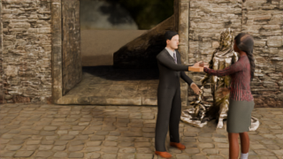

# ATLAS V0.6.2 delivery and reproduction

V0.6.2 adds versioned director contracts, a two-MPFB wrist-level prop exchange, and optional flat-ground ankle stabilization. Examples 27 and 28 use ordinary ATLAS projects and retain editable Blender files. [Current status](STATUS.md) · [Director contracts](DIRECTOR.md)

## Reproduce

Use the existing inspected MPFB library, KayKit walk bakes, V0.5.2 fort environment and `fort-line@1` audio. The curator and scholar pins and fort audio and media links are in the [V0.6 setup](V06_DEMOS.md). No additional credentials are needed for these local jobs.

```powershell
$python = '.\.venv\Scripts\python.exe'
$library = 'outputs/v052-library'
$motion = 'outputs/v06-release-motions'
$output = 'outputs/v062-renders'
& $python -m apps.cli capabilities
& $python -m apps.cli production handoff examples/27_v062_fort_handoff.json --asset-library $library --motion-cache $motion --audio-library outputs/v052-audio --asset-cache outputs/v052-acquisition --environment-collection examples/collections/stone_fort_approach.json --output $output
& $python -m apps.cli production preview examples/28_v062_guided_foot_lock.json --asset-library $library --motion-cache $motion --output $output
```

Use the resulting `project.json` to verify each MP4 with `atlas verify VIDEO --project PROJECT`. Use `atlas validate` with the same libraries for host preflight. Blender checks actual reach and contact at the start of a render. The project declares the parcel's initial owner, two named wrist anchors, two named prop-local grips, a world-space contact position for the prop origin, and reach, contact, transfer and release frames.

## Verified behavior

The scholar arrives at frame 13 and the curator arrives at frame 45, facing the scholar from 0.85 m away. Both arms reach after arrival, with contact from frames 56–64 and the ownership switch on frame 61. The receiver retains the prop through the release. The saved scene reopened with the ownership constraints active on the expected side of the switch.

| Measurement | Result |
| --- | ---: |
| Maximum reopened wrist-to-grip error | 0.00125 mm |
| Prop translation change at the switch | 0.00098 mm |
| Prop rotation change at the switch | 0 |
| Peak facial viseme during the contact window | 0.85 |
| Guided walk ankle drift on the same 29 stance pairs | 1.068 → 0.618 m/s |
| Guided walk lowest sampled shoe point | -2.80 → -2.86 mm |

The first fort setup was rejected because both wrists were beyond the measured arm lengths. Raising the authored contact from 1.16 m to 1.29 m brought the point into range with the original continuity threshold. The handoff follows named wrist positions and holds the authored parcel rotation. Natural finger grasp, collision-aware reach and further prop transitions remain open. The walking option holds world-space ankle positions over sampled stance spans with a 0.12 m correction bound and preserves the sampled foot orientation. Some sliding and stock gait exaggeration remain.



## Artifact measurements

| Preview | Local job | Output | Wall time | Job storage |
| --- | --- | --- | ---: | ---: |
| Fort handoff | `outputs/v062-renders/fort-archive-handoff-30c791ad997642e29fa85b4a7767e59e` | 320 × 180, 84 frames, 8.40 s, H.264 and AAC | 736.20 s | 409.80 MB |
| Guided correction | `outputs/v062-renders/guided-mpfb-foot-lock-d49f80442ed44e2e845dbf494157325b` | 368 × 208, 56 frames, 4.67 s, H.264 | 467.35 s | 37.51 MB |
| Dedicated service check | `outputs/v062-cli/handoff-service-proof-59d0cc1ced884fa091537937081cc466` | 64 × 64, 20 frames, 2.00 s, H.264 | 38.91 s | 68.09 MB |

The video jobs ran in Blender 5.2.3 LTS on CPU with concurrent tests and renders. The two longer jobs started before the package version update and retain their source hashes in the manifests. The dedicated service check uses version 0.6.2. The checked artifact hashes, timings and reopened scene measurements are in [machine-readable evidence](evidence/2026-11-25-v062.json).

## Tests

```powershell
$env:ATLAS_INTEGRATION = '1'
$env:ATLAS_MOTION_INTEGRATION = '1'
$env:ATLAS_HANDOFF_INTEGRATION = '1'
$env:PYTHONUTF8 = '1'
& $python -m pytest -q --junitxml=outputs/v062-verified.xml
```

The V0.6.2 regression run passed 346 tests in 448.23 seconds with Blender, motion and handoff integration enabled. Four tests were skipped for optional acquired-asset, Turbo and MPFB-generation integrations and Windows file-symlink privileges. The release default suite passed 316 tests with 34 skips. The handoff test renders a short MPFB scene and reopens `scene.blend`. The motion test bakes the licensed clip, checks cache reuse and reopens the animated result. The V0.6.2 wheel built and its handoff contract was checked from outside the repository. The V0.6 baseline passed 299 default tests with 33 skips, and its earlier all-provider run passed 331 tests with one Windows symlink privilege skip.

The production contract checkpoint is `0e3f571`. The V0.6.2 implementation is `46ddc6f`. [Implementation commit](https://github.com/dimalka-heshan/atlas-animation-engine/commit/46ddc6f2e4f6882334ae63e474373c6de3c7eab2) · [V0.7 handoff](DEVELOPMENT_HANDOFF.md)
