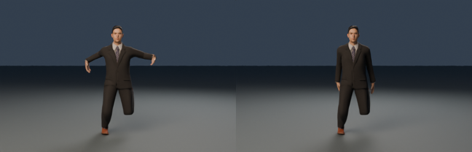

# ATLAS V0.6.3 anatomical retargeting

The old KayKit-to-MPFB bake reproduced the source arm flare and wrist angles before NLA blending or walking correction. It aligned bone-tail directions with a shortest-arc rotation, which left the transverse orientation uncalibrated and passed through stylized lateral movement. The captured/native comparison isolated the problem to arm transfer and motion selection. The existing MPFB bind geometry and native idle were much less extreme.

## Transfer and refinement

For each mapped arm segment, the source and target joint frames `A_s` and `A_t` are built from rest landmarks. The lengthwise axis joins the actual joints. A second direction fixes roll. For the MPFB palm the middle-finger base and index-to-pinky span define both directions. KayKit's intermediate wrist and CMU's hand pivot are validated independently on both sides. MPFB clavicle and finger ancestry is checked. The current donors provide no reliable finger poses, so the target fingers retain their native posture. CMU neck and clavicle rotations transfer where mapped.

For bind orientations `S_rest`, `T_rest` and the evaluated source orientation `S_pose`, the desired target arm orientation is `S_pose × inv(S_rest) × A_s × inv(A_t) × T_rest`. The solver converts this desired world orientation to a pose-basis quaternion through the actual target parent, including unmapped intermediate bones. Blender armatures are checked for meter scale, proper handedness and unskewed world axes.

The independent idle, walk, run and seated refinements reduce lateral swing and remap elbow motion while keeping signed fore/aft movement. They transport the MPFB wrist neutral with the receiving forearm and retain some source wrist deviation. Expressive KayKit gestures and the reviewed CMU takes use the calibrated base transfer. `--refinement none` is available for direct comparison. Running lower-body flight and multiphase transitions still need work.

## Matched measurement

The same curator, clip and sample timing were used for the old and corrected arms. The 24 fps production scene was reopened to measure both poses and hand-weighted mesh vertices.

| Evaluated left arm | Legacy | Corrected |
| --- | ---: | ---: |
| Peak lateral angle | 68.7° | 12.4° |
| Elbow flexion range | 68.2–96.9° | 21.6–27.4° |
| Peak wrist bend | 57.8° | 14.0° |

The old source and direct bake tracked the same lateral range before NLA ran. Native MPFB idle sampled near 10°. The unrefined new transfer retained roughly 69° of KayKit lateral range, making the category adjustment independently measurable. Front, rear, side and upper-body views show the arm improvement and the remaining high-knee stock gait. [Reproduction](V063_DEMOS.md)

## Human captures

Six reviewed MotionBuilder BVH files were acquired at a pinned mirror revision and baked through Blender's bundled importer from 120 Hz to 30 fps. They include `35_01` and `141_19` walks, `141_16` wave, `141_17` sit, `22_21` conversational pointing and `141_34` run. Both actors were tested. The importer verifies exact file hashes and preserves attribution and the upstream restriction on direct resale of motion data. [CMU terms](https://mocap.cs.cmu.edu/) · [Bruce Hahne's BVH conversion](https://sites.google.com/a/cgspeed.com/cgspeed/motion-capture/the-motionbuilder-friendly-bvh-conversion-release-of-cmus-motion-capture-database)

The captured wave and sit preserve horizontal weight shift, and the captured run preserves translation across the stage. Playback bounds retained travel separately from in-place pelvis movement. The two walks record endpoint displacement, excursion and sampled path length separately and strip XY travel for playback. The untrimmed captures play as one-shots. Guided navigation and looping require a qualified gait cycle. This avoids repeating take boundaries that showed about 42° and 51° of thigh rotation discontinuity.

## Cache and remaining scope

New bakes use `atlas-motion-2`. Their identity includes source clip and skeleton fingerprints, target asset and rest-skeleton fingerprints, the algorithm and mapping versions, the refinement mode, the Blender build, and the worker and calibration hashes. Legacy `atlas-motion-1` blobs remain readable by exact pins with a warning. Default discovery lists the current profile. Use `motions list --include-legacy` to see historical records.

This release corrects upper-arm and wrist behavior in the supported MPFB pipeline and preserves the existing arm IK and dialogue workflow. The walk and run sampler still shows stylized knees and abrupt transitions. The captured pointing take retains the arm gesture and peaks at 0.85 facial viseme weight during speech. Its lower-body pose includes unsupported seated contact with shoes as high as 443 mm above the floor. The donor bones provide no measured index articulation. The reopened captured run has a 62 mm minimum shoe penetration and 50 of 60 sampled frames where both shoes are more than 25 mm above the ground. Those measurements show that running flight and MPFB ground alignment still need calibration. A future correction should qualify a phase-aligned captured gait cycle and preserve the V0.6.3 arm, navigation, speech and handoff measurements.

## Regression and delivery

The guided scene retained the exact route destination within 1 µm. On the 29 selected stance pairs it retained the existing reduction from 1.068 to 0.618 m/s with an evaluated minimum shoe height of -2.86 mm. The fort transfer's measured displacement remained below 0.001 mm and reopened viseme weight reached 0.85 during both walking and contact.

The release cache contains 15 current bakes. The eight refined and expressive KayKit release samples matched exactly after the final rebake. The original exact legacy walk remains available for the comparison. A second request for the corrected curator walk hit the new cache. The earlier sampler job shows the captured wave before horizontal weight shift was retained. Example 33 uses the final captured translation.

| Preview | Local job under `outputs/v063-renders` | Frames at fps | CPU wall time | Job storage |
| --- | --- | ---: | ---: | ---: |
| Matched old/new walk | `anatomical-walk-comparison-75619f06989e4035813c3094bea5ef91` | 34 at 24 | 89.72 s | 48.97 MB |
| Guided walk and turn with foot correction | `guided-anatomical-walk-0a5cc55dc0ea42fb837f2a9d31ef2d2b` | 56 at 12 | 153.91 s | 36.59 MB |
| Carry, approach, dialogue and handoff | `fort-anatomical-handoff-96d4001ec68a413baf7d34b2e5272a53` | 84 at 10 | 1,048.69 s | 408.19 MB |
| Idle, walk, run, sit, stand and gesture study | `anatomical-motion-sampler-95c96e0934994306b2f5fb9a4b686b9c` | 137 at 24 | 686.15 s | 77.85 MB |
| Captured wave and conversational pointing with speech | `captured-conversational-gestures-7954ccda510b4398a7304b236ebd0302` | 76 at 10 | 734.55 s | 74.96 MB |
| Captured run with source travel | `captured-running-study-5c8552e28aa04c76862715b9bebf362e` | 60 at 24 | 559.14 s | 40.85 MB |

All six MP4s decoded. Their job times include concurrent CPU renders and tests. The comparison job also contains the matched full-body views and shoulder, elbow and wrist close-ups. The installed V0.6.3 wheel validated the captured run from outside the checkout. [Hashes and scene measurements](evidence/2026-11-25-v063.json)

The broader Blender, motion, handoff and CMU regression run passed 353 tests with four skips before the captured-travel follow-up. The skips were the separate acquired-asset, Turbo and MPFB-generation opt-ins and the Windows symlink privilege case. The final default suite passed 323 tests with 36 skips. The targeted anatomy, handoff and wave run passed 20 tests, and both focused CMU capture tests passed after the playback guard changed.

Implementation `39fd5e0` landed on GitHub main, followed by the reviewed capture travel playback guard in `426600a`. [Implementation](https://github.com/dimalka-heshan/atlas-animation-engine/commit/39fd5e0cc784624a7a39bcabe6e65dd1c384f717) · [Travel regression](https://github.com/dimalka-heshan/atlas-animation-engine/commit/426600aac22d22717fabd25fb5b6af5bebca716e)
