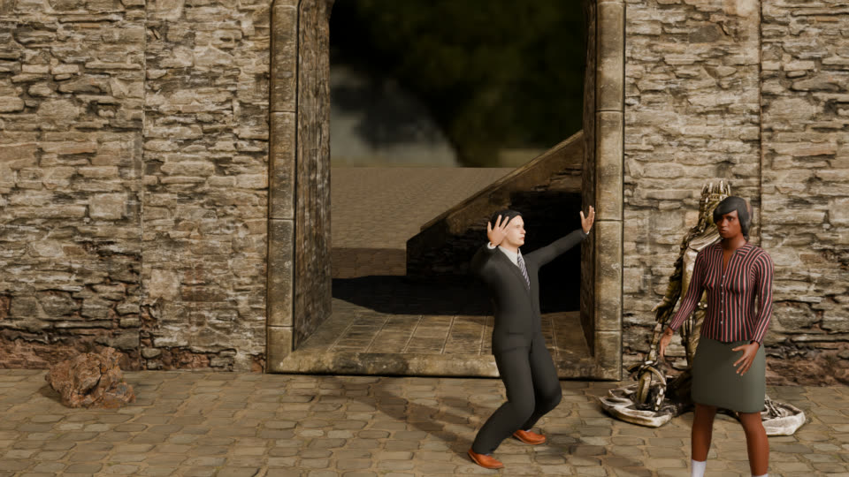

# ATLAS V0.6 delivery report

V0.6 makes licensed skeletal motions reusable on generated MPFB humans. Schema 1.5 compiles flat-ground destinations, waypoint routes and timed approaches into editable Blender transforms and Actions. The fort preview exercises retargeted movement, a two-actor approach, a moving camera, the previously generated Chatterbox-Turbo WAV and Rhubarb facial cues. [Reproduction](V06_DEMOS.md) · [Motion architecture](MOTION.md) · [Measured evidence](evidence/2026-11-25-v06.json)

## Source and compatibility

The single external skeletal source was the already-acquired CC0 KayKit Adventurers Knight by Kay Lousberg, `kaykit-knight@1`. No new archive was transferred. The source registry lists 69 inspected embedded clip names and ranges. Six distinct source Actions were attempted. Five yielded six usable baked records, including two target versions of `Walking_A`. These are authored stock skeletal animations. [Pinned source and license](https://github.com/KayKit-Game-Assets/KayKit-Character-Pack-Adventures-1.0/blob/672074b73ba276876a19e8816ecdc5241817ab47/addons/kaykit_character_pack_adventures/LICENSE.txt)

| Source Action | MPFB target | Measured outcome |
| --- | --- | --- |
| `Walking_A` | Curator and scholar | Both baked at 30 fps, 33 samples over 1.067 s. Estimated contact speeds 1.133 and 1.121 m/s. |
| `Idle` | Curator | Grounded bake completed. The route examples retain the embedded MPFB `HumanIdle` as their base. |
| `Running_B` | Curator | Grounded bake completed, estimated 3.328 m/s. The gait study used 3.00 m/s with authored roots. |
| `Running_A` | Curator | Grounded bake rejected because the correction exceeded the 0.32 m bound. |
| `Sit_Chair_Down` | Curator | Ungrounded bake completed. Chair reach and seat contact remain unverified. |
| `Cheer` | Curator | Ungrounded bake completed. The fort variant schedules it after arrival over the idle strip. |

The inspected KayKit and MPFB armatures have 41 and 53 bones respectively. The bake keys 18 mapped target bones and pelvis translation, storing a canonical rest fingerprint and input hashes. The original source library and baked cache remain local. Other rig families and FBX, BVH and USD are outside this transfer profile.

## Preview jobs

| Preview | Output | Wall time | Job storage |
| --- | --- | ---: | ---: |
| [Guided walk](../examples/23_v06_guided_walk.json) | 368 × 208, 56 frames, 4.67 s | 110.41 s | 37.50 MB |
| [Fort approach and dialogue](../examples/24_v06_fort_walking_dialogue.json) | 360 × 202, 78 frames, 7.80 s, AAC | 282.97 s | 411.47 MB |
| [Parallel walkers](../examples/25_v06_parallel_walk.json) | 352 × 198, 43 frames, 4.30 s | 62.80 s | 71.19 MB |
| [Walk, run and walk study](../examples/26_v06_walk_run_study.json) | 352 × 198, 52 frames, 4.33 s | 127.09 s | 36.92 MB |
| [Fort approach, speech and gesture](V06_DEMOS.md#fort-cut-with-a-gesture-after-arrival) | 320 × 180, 82 frames, 8.20 s, AAC | 488.03 s | 409.96 MB |

The machine-readable evidence lists the local job directories, exact video hashes, frame counts, reopened scene measurements and source pins. All five jobs have numbered PNGs, an editable `scene.blend`, and a fully decoded H.264 MP4. The initial fort and parallel jobs predate the reviewed start-heading correction. The guided walk, gait study and fort gesture cut use the published implementation.

## What the measurements show

- **Arrival and speed.** The guided actor covers 5.035 m in 46 frames of travel at 12 fps, from frame 5 through 51. Its realized speed is 1.314 m/s, with 1.159× clip playback. The route turns at (-0.91, -0.81) and stops at (1.30, -2.45). Reopened root errors were under 0.000001 m across the three configured movement shots. The fort curator stopped 1.270 m from the scholar after the scholar arrived. The simultaneous walkers traveled 3.501 m and 3.250 m at 1.129 m/s and 1.048 m/s on separate routes.
- **Grounding.** For the curator walk, source XY root displacement was zero. The skinned shoe minimum at bake samples improved from -20.5 to +84.4 mm down to within 0.001 mm of the flat floor. At full-weight samples in the reopened guided shot, the minimum ranged from -4.1 to +23.4 mm after blending, interpolation and playback-rate changes. The two fort walks ranged between -4.9 mm and floor level. Source sample contact indices and production frame contacts are recorded separately.
- **Sliding and gait quality.** The guided shot's mean contact ankle speed over 31 consecutive contact pairs was 1.03 m/s, with a 2.65 m/s peak. This is a world-XY ankle proxy for sliding, affected by ankle roll. The frames show remaining foot slide, high knees and wide arms from the retargeted stock gait. The run study forces a grounded support point even through the source flight phase. It shows a visible dip at walk–run changes, and the lowest shoe penetrates by as much as 66 mm in the final walking window. Phase-matched gait blending, horizontal foot locks and terrain IK remain open.
- **Body and face.** Reopened scenes had editable clip slots, distinct evaluated calf poses and deformed shoe vertices. The fort curator showed a peak jaw weight of 0.20 and a peak viseme weight of 0.85 during the measured walking window. Three blinks reached 0.95. In the gesture cut, frames 55–70 play the full-body `Cheer` Action after the curator arrives, while the viseme weight again reaches 0.85. The fort uses modern clothes and a stock gesture. Its wide framing provides limited lip detail.

## Performance and testing

On Windows with Blender 5.2.3 LTS and Intel CPU rendering, the two first walk bakes took 32.07 s and 24.78 s including import, retarget and vertical correction. A repeated CLI bake measured 1.30 s including startup and returned a cache hit. Guided route CLI preflight measured 0.71 s including asset and motion checks. Blender scene construction ranged from 3.15 to 22.59 s across the listed previews. The six baked records occupy 440,379 bytes, with 456,228 bytes for the complete local motion cache at measurement. These timings include work performed alongside other local jobs.

The V0.5.2 baseline passed 293 tests with one Windows file-symlink privilege skip. The final integration suite passed 331 tests with the same skip in 699.74 seconds. It enabled Blender, Turbo, acquired assets, MPFB and the new motion integration. The default suite passed 299 tests with 33 skips including opt-in integrations. All 38 focused motion tests passed, including a fresh licensed bake, cache reuse, render and independent Blender reopen. The V0.6 wheel built and validated the exact guided project from outside the checkout.

The implementation checkpoint is `f1c03898f422e8d23f2a4f66a2565f0a9cd8223e` on GitHub `main`. The next V0.6.2 task is to compile and verify one named-anchor prop handoff with explicit hand contact, ownership and release, using the current approach and dialogue workflow. [Implementation commit](https://github.com/dimalka-heshan/atlas-animation-engine/commit/f1c03898f422e8d23f2a4f66a2565f0a9cd8223e) · [Handoff](DEVELOPMENT_HANDOFF.md)
